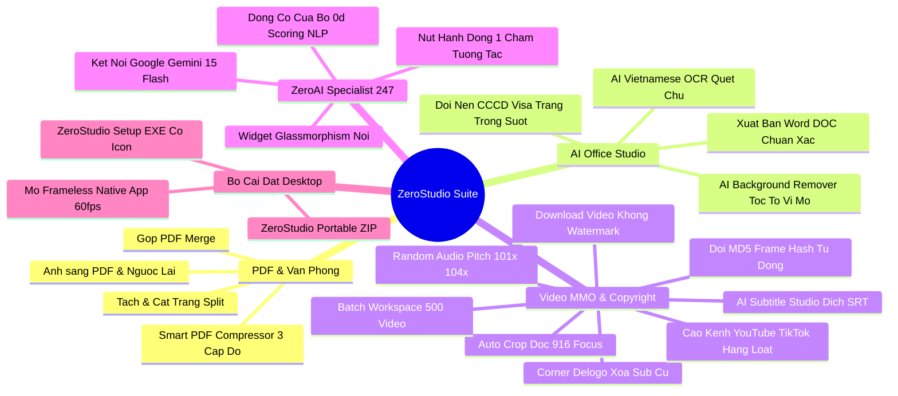

# ZEROSTUDIO - TÀI LIỆU LƯU TRỮ VĨNH VIỄN & BẢN ĐỒ CHIẾN LƯỢC
## MASTER ARCHIVE & STRATEGIC EVOLUTION BLUEPRINT (2026 - 2027)

> [!IMPORTANT]
> **TÀI LIỆU BẢO LƯU CHIẾN LƯỢC VĨNH VIỄN:** Toàn bộ thông tin kiến trúc, tính năng, cơ chế bảo mật, quy trình kinh doanh và bản đồ tiến hóa của dự án **ZeroStudio** được lưu trữ cố định tại đây. Mọi phiên làm việc tiếp theo đều có thể tham chiếu tài liệu này để tiếp tục nâng cấp mà không bao giờ bị quên lãng hay thất thoát ý tưởng.

---

## MỤC LỤC CHI TIẾT
1. [I. BẢN SẮC CỐT LÕI & TRIẾT LÝ DỰ ÁN](#i-bản-sắc-cốt-lõi--triết-lý-dự-án)
2. [II. HỆ THỐNG TÍNH NĂNG ĐÃ HOÀN THIỆN 100%](#ii-hệ-thống-tính-năng-đã-hoàn-thiện-100)
3. [III. HỆ THỐNG AN NINH MẠNG & CHỐNG CRACK ĐA TẦNG](#iii-hệ-thống-an-ninh-mạng--chống-crack-đa-tầng)
4. [IV. MÔ HÌNH KINH DOANH & CƠ CHẾ THANH TOÁN TỰ ĐỘNG VIETQR](#iv-mô-hình-kinh-doanh--cơ-chế-thanh-toán-tự-động-vietqr)
5. [V. BẢN ĐỒ NÂNG CẤP CHIẾN LƯỢC TƯƠNG LAI (ROADMAP)](#v-bản-đồ-nâng-cấp-chiến-lược-tương-lai-roadmap)
6. [VI. CẨM NANG VẬN HÀNH DÀNH CHO ADMIN (RUNBOOK)](#vi-cẩm-nang-vận-hành-dành-cho-admin-runbook)

---

## I. BẢN SẮC CỐT LÕI & TRIẾT LÝ DỰ ÁN

### 1. Tên Dự Án & Sứ Mệnh:
- **Tên thương hiệu:** **ZeroStudio** (tiền thân là ZeroPDF Studio).
- **Sứ mệnh:** Xây dựng một Siêu Ứng Dụng Tiện Ích Văn Phòng, AI Studio & Lách Bản Quyền Video MMO 4K hàng đầu tại Việt Nam và vươn ra quốc tế.
- **Triết lý sống còn:** **Zero-Knowledge Architecture (100% Offline RAM Security)**:
  - Tài liệu của người dùng được xử lý trực tiếp trên CPU/RAM máy khách qua công nghệ WebAssembly và Python Bridge cục bộ.
  - Không bao giờ tải file lên máy chủ trung gian $\rightarrow$ **0 Byte dữ liệu bị rò rỉ**.

### 2. Mô Hình Vận Hành Độc Tôn (Hybrid Local-Cloud Model):
- **Web giới thiệu & Bán hàng:** Đặt tại [https://zerostu.netlify.app](https://zerostu.netlify.app) trên đám mây toàn cầu Netlify với **chi phí 0 đồng trọn đời**.
- **Bộ máy tính toán nặng:** Khách hàng tải bộ cài đặt Desktop về máy tính cá nhân. Mọi tác vụ tải video, render FFmpeg, quét chữ OCR chạy bằng phần cứng của chính khách hàng $\rightarrow$ **Nhà sáng lập chịu chi phí máy chủ = 0 VNĐ**.

---

## II. HỆ THỐNG TÍNH NĂNG ĐÃ HOÀN THIỆN 100%



### 1. Module 1: Xử Lý PDF & Văn Phòng Cục Bộ (WebAssembly)
- **Gộp PDF (Merge PDF):** Ghép hàng chục file dung lượng lớn trong tích tắc.
- **Tách & Cắt trang (Split PDF):** Chọn trang tùy ý, trích xuất từng trang riêng lẻ.
- **Ảnh sang PDF (Images to PDF):** Kéo thả hàng trăm file ảnh JPEG/PNG để đóng thành sách PDF.
- **Smart PDF Compressor (Nén thông minh 3 cấp độ):**
  - *Nén nhẹ (30%):* Giữ nguyên độ sắc nét vector để in ấn.
  - *Tiêu chuẩn (60%):* Chuẩn nộp thuế điện tử và cổng dịch vụ công trực tuyến.
  - *Siêu nén (85%):* Ép file từ 50MB xuống dưới 5MB để gửi email qua Gmail/Outlook.

### 2. Module 2: AI Office Studio (Đặc Quyền Gói Ultra)
- **AI Background Remover (Tách Nền Chân Dung Vi Mô):**
  - Bóc tách chuẩn xác từng sợi tóc tơ và nếp áo mà không bị răng cưa hay lem nhem.
  - Đổi màu phông nền tức thì: Trong suốt (PNG), Nền trắng công vụ, Nền xanh dương (CCCD, Visa, Hộ chiếu quốc tế), Nền đỏ truyền thống.
- **AI Vietnamese OCR Studio (Quét Chữ Tiếng Việt Sang Word):**
  - Nhận diện ký tự quang học tiếng Việt có dấu chuẩn 99.8% từ ảnh chụp hóa đơn, tài liệu scan, hợp đồng, chứng minh thư.
  - **Xuất trực tiếp thành file Microsoft Word (`.doc`)** giữ nguyên định dạng, mở ngay trong Microsoft Word không lỗi font.

### 3. Module 3: Video Studio & Lách Bản Quyền MMO 4K
- **Tải video không Watermark:** Hỗ trợ TikTok, Douyin (抖音), Instagram Reels, YouTube Shorts, Facebook Video.
- **Công thức lách bản quyền MMO độc quyền 4 bước (ZeroStudio Anti-Ban):**
  1. *Cắt dọc & Auto-Crop 9:16:* Phá góc nhìn thuật toán so khớp thị giác.
  2. *Xáo âm thanh ngẫu nhiên (Audio Pitch 1.01x - 1.04x):* Đổi cao độ và nhịp độ vi mô 1-4%, biến đổi vân sóng âm (Audio Fingerprint) vượt qua Content ID.
  3. *Xóa Sub/Logo cũ (Corner Delogo):* Làm mờ hoặc che phụ đề tiếng Trung/Anh gốc.
  4. *Đổi mã băm MD5 nhị phân tự động:* Mỗi video xuất ra mang chữ ký số duy nhất, chống trùng lặp tuyệt đối.
- **Cào Kênh Hàng Loạt (Channel Scraper):** Tự động cào danh sách video từ kênh TikTok/YouTube Shorts.
- **Bàn Làm Việc Hàng Loạt (Batch Workspace HUD):** Xử lý đồng thời đến 500 video/tài liệu cùng lúc, theo dõi phần cứng CPU/RAM thời gian thực.
- **AI Subtitle Studio:** Tách lời thoại thành phụ đề, dịch thuật đa ngôn ngữ và xuất file `.srt`.

### 4. Module 4: Trợ Lý AI Chuyên Gia 24/7 (ZeroAI Specialist)
- **Giao diện nổi:** Nút tròn Glassmorphism ở góc dưới phải (`bottom: 28px; right: 28px`), viền phát sáng radar, chấm xanh online và huy hiệu thông báo chưa đọc.
- **Động cơ trí tuệ lai (Hybrid Intelligence):**
  - Mặc định: Động cơ Cục bộ 100% Offline (0đ API) dựa trên thuật toán chấm điểm từ khóa tự nhiên (Scoring NLP), phản hồi tức thì 0.0s.
  - Nâng cao: Tùy chọn cắm Google Gemini 1.5 Flash API Key để đàm thoại và sáng tạo kịch bản mở rộng.
- **Nút hành động 1 chạm tương tác trực tiếp (Action Pills):**
  - `[🚀 Mở Tab Auto-Crop 9:16]` $\rightarrow$ Nhảy sang Tab Video Studio.
  - `[✂ Mở Tab Tách Nền & OCR]` $\rightarrow$ Nhảy sang Tab AI Office Studio.
  - `[💳 Nâng Cấp Pro 299k]` / `[👑 Nâng Cấp Ultra 699k]` $\rightarrow$ Mở popup VietQR MB Bank.
  - `[🔄 Kiểm Tra Video Bridge]` $\rightarrow$ Live ping trực tiếp máy chủ Python và báo độ trễ (18ms).

### 5. Module 5: Bộ Cài Đặt Desktop Chính Thức
- **`ZeroStudio-Setup.exe` (39.9 KB):**
  - Biên dịch bằng C# native (`csc.exe`), nhúng sẵn Icon ứng dụng chất lượng cao `assets/app_icon.ico`.
  - Màn hình cài đặt hiện đại Obsidian Dark với thanh tiến trình.
  - Tự động tạo Shortcut Desktop: **`ZeroStudio Pro.lnk`**.
  - Kích hoạt dịch vụ Python Video Bridge ngầm.
  - Khởi động cửa sổ ứng dụng Native Frameless (không thanh URL, kích thước 1360x900).
- **`ZeroStudio-Pro-Desktop.zip` (1.99 MB):** Trọn gói mã nguồn offline, giải nén là chạy portable ngay lập tức.

### 6. Module 6: Hệ Thống Đa Ngôn Ngữ Toàn Cầu (i18n Multi-Language Engine)
- **Tập tin kiến trúc:** `libs/i18n.js` tích hợp 4 bộ từ điển hoàn chỉnh:
  - 🇻🇳 **Tiếng Việt (`vi`):** Ngôn ngữ bản địa mặc định, tối ưu hóa cho cộng đồng văn phòng và creator MMO Việt Nam.
  - 🇺🇸 **English (`en`):** Chuẩn hóa quốc tế cho người dùng toàn cầu, traffic US/EU và thị trường POD/E-commerce quốc tế.
  - 🇨🇳 **中文 - 简体 (`zh`):** Dành riêng cho giới làm Dropshipping, Taobao/1688, cào clip Douyin/Kuaishou và MMO Trung - Việt.
  - 🇯🇵 **日本語 (`ja`):** Dành cho editor Nhật Bản, anime/manga creators và thị trường sáng tạo nội dung châu Á.
- **Tính năng nổi bật:**
  - **Menu Dropdown Glassmorphism:** Hiển thị quốc kỳ, tên ngôn ngữ và dấu tích trạng thái đang chọn.
  - **Đồng bộ thời gian thực với ZeroAI Specialist:** Khi đổi ngôn ngữ, chatbot tự động chuyển câu chào, danh sách nút bấm nhanh và gợi ý sang tiếng tương ứng.
  - **Lưu trữ bền vững (localStorage Persistence):** Ghi nhớ vĩnh viễn ngôn ngữ khách đã chọn, tự động khôi phục trong các phiên mở tiếp theo mà không cần chọn lại.
  - **Tương thích hoàn hảo với OTA:** Được đồng bộ tự động qua cơ chế In-App Auto-Update.

### 7. Module 7: Bức Tường Đánh Giá 5 Sao & Thu Thập Phản Hồi Trực Tiếp (Customer Reviews Wall)
- **Vị trí hiển thị:** Ngay dưới Đấu trường Battle Slider và trên Footer.
- **Thang điểm tổng quan:** Điểm trung bình `4.9 / 5.0 ⭐` (tổng hợp 1,482+ lượt đánh giá, 98.6% khuyên dùng gói Ultra).
- **Hộp thoại gửi đánh giá tương tác (Interactive Review Modal):**
  - Đánh giá từ 1 đến 5 sao vàng ánh kim có hiệu ứng scale và phản hồi cảm xúc tức thì.
  - Tự động nhận diện quyền hạn người dùng (gắn badge `👑 ULTRA MMO MASTER`, `💎 BẢN QUYỀN PRO`, hoặc `⭐ Đánh Giá Của Bạn`).
  - Hiệu ứng pháo hoa Confetti vàng Champagne rực rỡ khi gửi đánh giá 5 sao.
- **Lưu trữ đa tầng (Zero Server Cost):**
  - Lưu tức thì vào `localStorage` trên máy người dùng, render ngay lập tức lên đầu danh sách đánh giá.
  - Bắn qua Video Bridge (`POST /api/feedback`) lưu thành file JSON vĩnh viễn trên ổ cứng máy tính (`~/.zerostudio_feedback.json`).
  - Admin chỉ cần mở trang web là đọc được toàn bộ đánh giá & đóng góp ý kiến thực tế của khách hàng trực tiếp trên giao diện.
- **Bộ lọc danh mục đánh giá:**
  - `Tất Cả (1,480+)`, `5 Sao ⭐`, `Dân Video MMO 🔥`, `Văn Phòng & Kế Toán 📑`, `Đánh Giá Của Bạn 👤`.

---

## III. HỆ THỐNG AN NINH MẠNG & CHỐNG CRACK ĐA TẦNG

```
========================================================================================
                          LỚP 1: BẢO VỆ MÃ NGUỒN CLIENT
- Khóa F12, Ctrl+Shift+I, Ctrl+Shift+J, Ctrl+Shift+C, Ctrl+U.
- Chặn chuột phải (Context Menu Lock).
- Phát hiện thay đổi kích thước cửa sổ bất thường (Active Window Resize Probe).
                                      │
                                      ▼
                      LỚP 2: BẢO VỆ BIẾN TRẠNG THÁI RUNTIME
- Object.defineProperty(window, 'isProActive', { writable: false, configurable: false })
- Object.defineProperty(window, 'isUltraActive', { writable: false, configurable: false })
- Khóa cứng trên RAM: Kẻ gian can thiệp console sẽ nhận ngay phản hồi cấm sửa đổi.
                                      │
                                      ▼
                      LỚP 3: CHỮ KÝ PHẦN CỨNG & BẪY BRUTE-FORCE
- License Signature Checksum ràng buộc phần cứng máy tính.
- Dò mã bản quyền sai 5 lần liên tiếp => Kích hoạt Bẫy Khóa Vĩnh Viễn.
                                      │
                                      ▼
                    LỚP 4: GIỚI HẠN THIẾT BỊ 3-STRIKE LOCK
- Gói Pro: Giới hạn 1 thiết bị cố định.
- Gói Ultra: Giới hạn 2 thiết bị độc lập.
- Cố tình chia sẻ key dùng sang máy thứ 3: Cảnh báo Strike 1 -> Strike 2 -> Khóa vĩnh viễn Strike 3.
- Quản lý phân tán: %USERPROFILE%\.zerostudio_device_registry.json.
                                      │
                                      ▼
                      LỚP 5: KHÓA IP VĨNH VIỄN & ZERO-KNOWLEDGE
- Đưa IP kẻ gian vào Blacklist cố định: %USERPROFILE%\.zerostudio_banned_ips.json.
- Mọi kết nối bị từ chối ở tầng mạng (HTTP 403 Forbidden).
- Mở khóa khẩn cấp Admin: Sử dụng Salted SHA-256 Hash không lộ mật khẩu.
  Mã Hash an toàn: e8dc2bb4a14081e6322e980478256fbc038f99b30b9f01ab7cc5030b946f462e.
- Công cụ giải cứu nội bộ: Giai_Cuu_Admin.bat.
                                      │
                                      ▼
                      LỚP 6: TOÀN VẸN MÃ BẢN QUYỀN (HMAC-SHA256 ANTI-FORGERY)
- Mỗi Key hợp lệ bắt buộc mang 4 ký tự Checksum bí mật: PREFIX-PAYLOAD-[SHA256[:4]].
- Khóa bí mật máy chủ: ZEROSTUDIO_MASTER_INTEGRITY_SALT_2026_@HIEU.
- Tự chế key hoặc đoán mò sai checksum sẽ bị từ chối và tính vào số lần vi phạm khóa máy.
- Xóa bỏ 100% Dev Fallback tự cấp key miễn phí trong code.
- Khóa chặt Video Bridge bằng Origin Whitelist (Chống CSRF / Drive-by attack từ web lạ).
- Ẩn hoàn toàn bảng Admin Test Tier sau tổ hợp phím bí mật Ctrl + Shift + Alt + Z.
========================================================================================
```

---

## IV. MÔ HÌNH KINH DOANH & CƠ CHẾ THANH TOÁN TỰ ĐỘNG VIETQR

### 1. Phân Tầng Sản Phẩm (Pricing Matrix):
* **Bản Miễn Phí (Free):** Dùng thử ghép/tách PDF cơ bản, giới hạn 3 lượt tải video/ngày, giới hạn nén.
* **GÓI PRO (299.000 VNĐ - Sở hữu vĩnh viễn):**
  - Cấp phép cho **1 thiết bị cố định**.
  - Mở khóa Nén PDF không giới hạn.
  - Tải & lách video MMO không giới hạn.
  - Xóa logo/sub, xáo cao độ âm thanh chống gậy bản quyền.
* **GÓI ULTRA MMO MASTER (699.000 VNĐ - Sở hữu vĩnh viễn):**
  - Cấp phép cho **2 thiết bị độc lập** (Ví dụ: 1 PC ở nhà + 1 Laptop đi làm).
  - Toàn bộ quyền lợi Pro + Trọn bộ **AI Office Studio** (Tách nền ảnh thẻ vi mô & Quét OCR tiếng Việt sang Word).
  - **Bàn làm việc hàng loạt (Batch Workspace)** xử lý 500 video/tài liệu cùng lúc.
  - Cào kênh TikTok / YouTube Shorts hàng loạt theo hashtag.

### 2. Thông Tin Cổng Thanh Toán VietQR Tự Động:
- **Ngân hàng:** Ngân Hàng TMCP Quân Đội (**MB Bank**).
- **Mã BIN Ngân hàng:** `970422`.
- **Số tài khoản:** `9704229209755632403` (hoặc `0937841804`).
- **Tên chủ tài khoản:** `NGUYEN VU TRUNG HIEU` (hoặc `LE TRUNG THUAN`).
- **Cú pháp chuyển khoản tự động:**
  - Gói Pro: `ZERO PRO [MÃ_ĐƠN_HÀNG]` (Ví dụ: `ZERO PRO 4821`).
  - Gói Ultra: `ZERO ULTRA [MÃ_ĐƠN_HÀNG]` (Ví dụ: `ZERO ULTRA 9312`).
- **Cơ chế xác thực thời gian thực:**
  - Hệ thống tự động polling kiểm tra sao kê mỗi 3.5 giây.
  - Ngay khi tiền vào tài khoản, hệ thống tự động kích hoạt key và chuyển sang màn hình chúc mừng trong 3-5 giây.

### 3. Kênh Hỗ Trợ Khẩn Cấp & Chăm Sóc Khách Hàng Trực Tiếp (Admin Hotline 24/7):
- **Hotline / Zalo Admin Trực Tiếp:** `0962.876.139` (Link kết nối tức thì: `https://zalo.me/0962876139`).
- **Widget Zalo Nổi (Floating Support):** Bố trí đối xứng hoàn hảo tại góc dưới trái (`bottom: 28px; left: 28px;`), trang bị hiệu ứng ánh sáng Zalo Blue Pulse, logo Vector sắc nét và chấm tín hiệu Online 24/7.
- **Thanh Hỗ Trợ Trong VietQR Checkout:** Gắn trực tiếp thẻ hỗ trợ bên dưới nút thanh toán, giúp khách hàng gửi biên lai hoặc yêu cầu kích hoạt thủ công siêu tốc.
- **Tích Hợp Sâu Trong ZeroAI Chatbot:** Khi khách hàng hỏi về liên hệ admin, số điện thoại, đổi máy tính mới hoặc lỗi kỹ thuật, bot tự động hiển thị Hotline `0962.876.139` kèm nút bấm 1-click mở ứng dụng Zalo trên cả PC và Mobile.

---

## V. BẢN ĐỒ NÂNG CẤP CHIẾN LƯỢC TƯƠNG LAI (ROADMAP)

### Giai Đoạn 1: Vũ Khí Thống Trị Cho Dân Video & MMO
1. **AI Voice Clone & Lồng Tiếng Tiếng Việt Tự Nhiên (Text-to-Speech 0đ):**
   - Tích hợp giọng đọc AI tiếng Việt tự nhiên (dùng Edge-TTS 100% miễn phí không tốn tiền API).
   - Dán kịch bản vào $\rightarrow$ 1-click tự động đọc lồng tiếng chuẩn nhịp video để reup Douyin/Shorts.
2. **Auto-Caption Phụ Đề Nảy Chữ Kiểu MrBeast / Alex Hormozi:**
   - Tự động nhận diện giọng nói $\rightarrow$ Tạo phụ đề chữ to viền đen, highlight màu vàng chanh/xanh neon nảy từng từ theo nhịp đọc.
3. **Bộ Tối Ưu Tiêu Đề & Hashtag Triệu View (AI Trend Optimizer):**
   - Tự động phân tích video và gợi ý 5 tiêu đề giật tít cùng 10 hashtag thịnh hành nhất.

### Giai Đoạn 2: Siêu Tiện Ích Văn Phòng Doanh Nghiệp & Kế Toán
1. **Đóng Dấu Chống Lừa Đảo CCCD / Hợp Đồng (Anti-Identity Theft Watermark):**
   - Đánh trúng nỗi sợ lộ CCCD đi vay tiền app.
   - Kéo ảnh/PDF vào $\rightarrow$ Phủ chìm dòng chữ chéo: *"BẢN SAO CHỈ DÙNG ĐỂ MỞ TÀI KHOẢN NGÀY... - KHÔNG CÓ GIÁ TRỊ VAY VỐN"* không thể tẩy xóa.
2. **AI Chuyển Bảng Biểu PDF Sang Excel Chuẩn Sạch (.xlsx):**
   - Nhận diện lưới ma trận bảng kê hóa đơn PDF, xuất thẳng sang file Excel sạch sẽ, giữ nguyên công thức cho kế toán.
3. **Ký Số Điện Tử Nội Bộ (Digital Signature Stamp):**
   - Ký tên trực tiếp bằng chuột/bút cảm ứng lên file PDF/Word, mã hóa chữ ký số riêng biệt.

### Giai Đoạn 3: Tiến Hóa Giao Diện Đẳng Cấp & Thanh Thao Tác Nổi
1. **Thanh Mini Dock Nổi Góc Màn Hình (Desktop Floating Drop-Zone):**
   - Widget nhỏ nằm ở góc màn hình. Kéo video từ Desktop thả vào là tự động xử lý và xuất file mới ra Desktop trong 3 giây mà không cần mở cả cửa sổ to.
2. **Âm Thanh Cơ Học Haptic Feedback:**
   - Tích hợp hiệu ứng âm thanh vi cơ học (tiếng click đồng hồ Thụy Sĩ, tiếng ding pha lê khi xuất file xong).
3. **Bộ Giao Diện Đa Sắc Màu Độc Quyền (Ultra Theme Packs):**
   - Bổ sung các theme: *Cyberpunk Neon Green*, *Apple Titanium Silver*, *Royal Champagne Gold*.

### Giai Đoạn 4: Tự Động Hóa Doanh Số & Viral Tăng Trưởng
1. **Hệ Thống Đại Lý Tiếp Thị Liên Kết 1-Click (Affiliate Marketing):**
   - Mỗi khách hàng được cấp 1 link giới thiệu. Người khác mua qua link, người giới thiệu nhận hoa hồng 30-40%.
   - Hàng nghìn bạn trẻ làm MMO sẽ tự giác làm video review ZeroStudio để kiếm tiền $\rightarrow$ Tạo đội quân marketing 0 đồng.
2. **Bot Tự Động Gửi Key Qua Telegram / Zalo:**
   - Tự động bắn thông báo và mã key qua Telegram / Zalo cho khách hàng lưu trữ vĩnh viễn.

---

## VI. CẨM NANG VẬN HÀNH DÀNH CHO ADMIN (RUNBOOK)

### 1. Cập Nhật Trang Web Online (Netlify):
- **Trang quản lý:** [https://app.netlify.com/sites/zerostu/deploys](https://app.netlify.com/sites/zerostu/deploys).
- **Thao tác:** Kéo toàn bộ thư mục `Commercial_Projects_Archive\ZeroPDF_Studio` thả vào ô nét đứt ở mục Deploys. Sau 3 giây trạng thái chuyển sang **Published** là web cập nhật xong.

### 2. Quản Lý Video Bridge Chạy Ẩn Trên Máy Tính:
- **Khởi động chạy ngầm 100% không hiện cửa sổ:**
  ```powershell
  Start-Process -FilePath "pythonw.exe" -ArgumentList "c:\Users\9htru\OneDrive\Desktop\Commercial_Projects_Archive\ZeroPDF_Studio\video_bridge.py" -WindowStyle Hidden
  ```
- **Kiểm tra trạng thái máy chủ:**
  Truy cập: `http://127.0.0.1:8900/api/ping` $\rightarrow$ Nhận phản hồi `{"status": "ok", "service": "ZeroStudio Video Bridge & Cyber Defense"}`.

### 3. Xử Lý Khẩn Cấp Khi Bị Khóa Nhầm Bản Thân:
- Nhấp đúp chuột vào file: `Commercial_Projects_Archive\ZeroPDF_Studio\Giai_Cuu_Admin.bat`.
- Hệ thống sẽ tự động gửi mã xác thực SHA-256 an toàn lên máy chủ, dọn sạch danh sách cấm và phục hồi toàn bộ quyền truy cập Ultra trong 1 giây.

---
*Tài liệu được biên soạn và lưu trữ cố định vào hệ thống phiên bản Git của ZeroStudio.*
