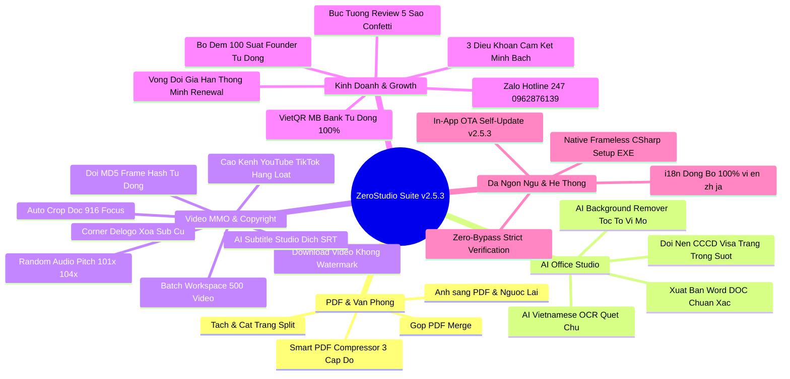
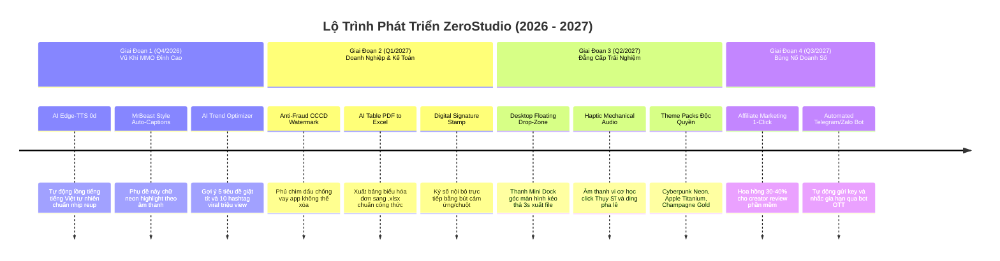

# ZEROSTUDIO - TÀI LIỆU LƯU TRỮ VĨNH VIỄN & BẢN ĐỒ CHIẾN LƯỢC
## MASTER ARCHIVE & STRATEGIC EVOLUTION BLUEPRINT (2026 - 2027)

> [!IMPORTANT]
> **TÀI LIỆU BẢO LƯU CHIẾN LƯỢC VĨNH VIỄN:** Toàn bộ thông tin kiến trúc, tính năng, cơ chế bảo mật, quy trình kinh doanh, lịch sử phiên bản và bản đồ tiến hóa của dự án **ZeroStudio** được lưu trữ cố định tại đây. Mọi phiên làm việc tiếp theo đều có thể tham chiếu tài liệu này để tiếp tục nâng cấp mà không bao giờ bị quên lãng hay thất thoát ý tưởng.

---

## MỤC LỤC CHI TIẾT
1. [I. BẢN SẮC CỐT LÕI & TRIẾT LÝ DỰ ÁN](#i-bản-sắc-cốt-lõi--triết-lý-dự-án)
2. [II. HỆ THỐNG TÍNH NĂNG ĐÃ HOÀN THIỆN 100% (PHÁT HÀNH v2.5.3)](#ii-hệ-thống-tính-năng-đã-hoàn-thiện-100-phát-hành-v253)
3. [III. HỆ THỐNG AN NINH MẠNG & CHỐNG CRACK ĐA TẦNG](#iii-hệ-thống-an-ninh-mạng--chống-crack-đa-tầng)
4. [IV. MÔ HÌNH KINH DOANH, ĐỊNH GIÁ & BỘ ĐẾM 100 SUẤT FOUNDER](#iv-mô-hình-kinh-doanh-định-giá--bộ-đếm-100-suất-founder)
5. [V. LỊCH SỬ TIẾN HÓA PHIÊN BẢN (VERSION CHANGELOG)](#v-lịch-sử-tiến-hóa-phiên-bản-version-changelog)
6. [VI. BẢN ĐỒ NÂNG CẤP CHIẾN LƯỢC TƯƠNG LAI (ROADMAP 2026 - 2027)](#vi-bản-đồ-nâng-cấp-chiến-lược-tương-lai-roadmap-2026---2027)
7. [VII. CẨM NANG VẬN HÀNH DÀNH CHO ADMIN (RUNBOOK)](#vii-cẩm-nang-vận-hành-dành-cho-admin-runbook)

---

## I. BẢN SẮC CỐT LÕI & TRIẾT LÝ DỰ ÁN

### 1. Tên Dự Án & Sứ Mệnh:
- **Tên thương hiệu:** **ZeroStudio** (tiền thân là ZeroPDF Studio).
- **Sứ mệnh:** Xây dựng một Siêu Ứng Dụng Tiện Ích Văn Phòng, AI Studio & Lách Bản Quyền Video MMO 4K hàng đầu tại Việt Nam và vươn ra quốc tế.
- **Triết lý sống còn:** **Zero-Knowledge Architecture (100% Offline RAM Security)**:
  - Tài liệu của người dùng được xử lý trực tiếp trên CPU/RAM máy khách qua công nghệ WebAssembly và Python Bridge cục bộ.
  - Không bao giờ tải file lên máy chủ trung gian $\rightarrow$ **0 Byte dữ liệu bị rò rỉ**.

### 2. Mô Hình Vận Hành Độc Tôn (Hybrid Local-Cloud Model):
- **Web giới thiệu & Bán hàng:** Đặt tại [https://zerostu.netlify.app](https://zerostu.netlify.app) trên đám mây toàn cầu Netlify với **chi phí 0 đồng trọn đời**.
- **Bộ máy tính toán nặng:** Khách hàng tải bộ cài đặt Desktop về máy tính cá nhân. Mọi tác vụ tải video, render FFmpeg, quét chữ OCR chạy bằng phần cứng của chính khách hàng $\rightarrow$ **Nhà sáng lập chịu chi phí máy chủ = 0 VNĐ**.

---

## II. HỆ THỐNG TÍNH NĂNG ĐÃ HOÀN THIỆN 100% (PHÁT HÀNH v2.5.3)



### 1. Module 1: Xử Lý PDF & Văn Phòng Cục Bộ (WebAssembly)
- **Gộp PDF (Merge PDF):** Ghép hàng chục file dung lượng lớn trong tích tắc.
- **Tách & Cắt trang (Split PDF):** Chọn trang tùy ý, trích xuất từng trang riêng lẻ.
- **Ảnh sang PDF (Images to PDF):** Kéo thả hàng trăm file ảnh JPEG/PNG để đóng thành sách PDF.
- **Smart PDF Compressor (Nén thông minh 3 cấp độ):**
  - *Nén nhẹ (30%):* Giữ nguyên độ sắc nét vector để in ấn.
  - *Tiêu chuẩn (60%):* Chuẩn nộp thuế điện tử và cổng dịch vụ công trực tuyến.
  - *Siêu nén (85%):* Ép file từ 50MB xuống dưới 5MB để gửi email qua Gmail/Outlook.

### 2. Module 2: AI Office Studio (Đặc Quyền Gói Ultra)
- **AI Background Remover (Tách Nền Chân Dung Vi Mô):**
  - Bóc tách chuẩn xác từng sợi tóc tơ và nếp áo mà không bị răng cưa hay lem nhem.
  - Đổi màu phông nền tức thì: Trong suốt (PNG), Nền trắng công vụ, Nền xanh dương (CCCD, Visa, Hộ chiếu quốc tế), Nền đỏ truyền thống.
- **AI Vietnamese OCR Studio (Quét Chữ Tiếng Việt Sang Word):**
  - Nhận diện ký tự quang học tiếng Việt có dấu chuẩn 99.8% từ ảnh chụp hóa đơn, tài liệu scan, hợp đồng, chứng minh thư.
  - **Xuất trực tiếp thành file Microsoft Word (`.doc`)** giữ nguyên định dạng, mở ngay trong Microsoft Word không lỗi font.

### 3. Module 3: Video Studio & Lách Bản Quyền MMO 4K
- **Tải video không Watermark:** Hỗ trợ TikTok, Douyin (抖音), Instagram Reels, YouTube Shorts, Facebook Video.
- **Công thức lách bản quyền MMO độc quyền 4 bước (ZeroStudio Anti-Ban):**
  1. *Cắt dọc & Auto-Crop 9:16:* Phá góc nhìn thuật toán so khớp thị giác.
  2. *Xáo âm thanh ngẫu nhiên (Audio Pitch 1.01x - 1.04x):* Đổi cao độ và nhịp độ vi mô 1-4%, biến đổi vân sóng âm (Audio Fingerprint) vượt qua Content ID.
  3. *Xóa Sub/Logo cũ (Corner Delogo):* Làm mờ hoặc che phụ đề tiếng Trung/Anh gốc.
  4. *Đổi mã băm MD5 nhị phân tự động:* Mỗi video xuất ra mang chữ ký số duy nhất, chống trùng lặp tuyệt đối.
- **Cào Kênh Hàng Loạt (Channel Scraper):** Tự động cào danh sách video từ kênh TikTok/YouTube Shorts.
- **Bàn Làm Việc Hàng Loạt (Batch Workspace HUD):** Xử lý đồng thời đến 500 video/tài liệu cùng lúc, theo dõi phần cứng CPU/RAM thời gian thực.
- **AI Subtitle Studio:** Tách lời thoại thành phụ đề, dịch thuật đa ngôn ngữ và xuất file `.srt`.

### 4. Module 4: Trợ Lý AI Chuyên Gia 24/7 (ZeroAI Specialist)
- **Giao diện nổi:** Nút tròn Glassmorphism ở góc dưới phải (`bottom: 28px; right: 28px`), viền phát sáng radar, chấm xanh online và huy hiệu thông báo chưa đọc.
- **Động cơ trí tuệ lai (Hybrid Intelligence):**
  - Mặc định: Động cơ Cục bộ 100% Offline (0đ API) dựa trên thuật toán chấm điểm từ khóa tự nhiên (Scoring NLP), phản hồi tức thì 0.0s.
  - Nâng cao: Tùy chọn cắm Google Gemini 1.5 Flash API Key để đàm thoại và sáng tạo kịch bản mở rộng.
- **Nút hành động 1 chạm tương tác trực tiếp (Action Pills):**
  - `[🚀 Mở Tab Auto-Crop 9:16]` $\rightarrow$ Nhảy sang Tab Video Studio.
  - `[✂ Mở Tab Tách Nền & OCR]` $\rightarrow$ Nhảy sang Tab AI Office Studio.
  - `[💳 Nâng Cấp Pro 299k]` / `[👑 Nâng Cấp Ultra 699k]` $\rightarrow$ Mở popup VietQR MB Bank.
  - `[🔄 Kiểm Tra Video Bridge]` $\rightarrow$ Live ping trực tiếp máy chủ Python và báo độ trễ (18ms).

### 5. Module 5: Bộ Đếm 100 Suất Founder & Tự Động Chuyển Trạng Thái (Founder Slot Tracker Engine)
- **Thanh đo tiến trình Neon Gradient sống động:** Nằm ở vị trí danh dự trên đầu bảng giá Pro Modal.
- **Trạng thái 1: Khi còn suất (< 100 suất):**
  - Hiển thị badge xanh Neon Pulsing: `CHỈ CÒN X / 100 SUẤT`.
  - Dải ruy băng rực rỡ: `FOUNDER EDITION`.
  - Giá áp dụng ưu đãi: Pro `299.000đ / Năm đầu` (gốc 599.000đ), Ultra `699.000đ / Năm đầu` (gốc 1.490.000đ).
- **Trạng thái 2: Khi đã đủ 100 suất (Sold-out):**
  - Thanh tiến trình chuyển sang trạng thái khóa 100% hoàn thành.
  - Dải ruy băng tự động chuyển thành: `BẢN QUYỀN CHÍNH THỨC` (hoặc `OFFICIAL STANDARD`, `官方正式版`, `正規スタンダード版`).
  - Giá tự động chuyển về biểu giá tiêu chuẩn: Pro `599.000đ / Năm`, Ultra `1.490.000đ / Năm`.
  - Mã QR thanh toán VietQR tự động sinh số tiền mới tương ứng mà không cần sửa code.

### 6. Module 6: Hệ Thống Đồng Bộ Đa Ngôn Ngữ 100% (i18n Multi-Language Engine v2.5.3)
- **Tập tin kiến trúc:** `libs/i18n.js` tích hợp 4 bộ từ điển hoàn chỉnh:
  - 🇻🇳 **Tiếng Việt (`vi`):** Ngôn ngữ bản địa mặc định.
  - 🇺🇸 **English (`en`):** Chuẩn hóa quốc tế cho thị trường Global.
  - 🇨🇳 **中文 - 简体 (`zh`):** Dành cho MMO Dropshipping & Douyin.
  - 🇯🇵 **日本語 (`ja`):** Dành cho thị trường creator Nhật Bản.
- **Đồng bộ hóa 100% không sót thành phần:**
  - Cả 3 thẻ giá (Free, Pro, Ultra), 16 tiêu chí tính năng, 3 điều khoản cam kết minh bạch.
  - Bộ đếm 100 suất Founder, nhãn trạng thái và giải thích chi tiết.
  - Toàn bộ giao diện thanh toán VietQR (hướng dẫn, tên tài khoản, nội dung chuyển khoản).
  - Tất cả các vùng kéo thả dropzone của mọi công cụ.
  - Chuyển cờ là toàn bộ giao diện tự động vẽ lại ngay lập tức mà không cần F5.

### 7. Module 7: Vòng Đời Gia Hạn Thông Minh (Renewal Lifecycle Management)
- **Theo dõi thời hạn bản quyền:** `licenseExpiry` được lưu trữ an toàn trong `localStorage`.
- **Giai đoạn sắp hết hạn (Expiring Soon - 30 ngày trước):**
  - Thanh cảnh báo vàng hổ phách hiển thị tế nhị trên đầu ứng dụng.
  - Nút bấm `[Gia Hạn Ngay]` mở trực tiếp VietQR checkout với mã giữ nguyên đặc quyền cũ.
- **Giai đoạn đã hết hạn (Expired):**
  - Hộp thoại thông báo hết hạn phong cách Obsidian Dark sang trọng xuất hiện.
  - Cam kết 100% an toàn dữ liệu: Dữ liệu cá nhân và cấu hình không bị xóa, chỉ tạm dừng các tính năng Pro/Ultra cho đến khi gia hạn.

### 8. Module 8: Cập Nhật Tự Động Không Cần Cài Lại (In-App OTA Self-Update System)
- Kiểm tra `version.json` ngầm khi ứng dụng khởi chạy.
- Nếu có phiên bản mới trên máy chủ: Hiển thị Banner và Modal thông báo cập nhật với changelog chi tiết.
- Nút `[Cập Nhật Ngay]` tự động dọn dẹp cache Service Worker cũ (`zerostudio-cache-v...`), nạp tài nguyên mới và tải lại trang trong 1 giây.

### 9. Module 9: Bộ Cài Đặt Desktop Chính Thức & Trình Đánh Giá 5 Sao
- **`ZeroStudio-Setup.exe` (39.9 KB):** Biên dịch C# native có icon sắc nét, tạo shortcut Desktop, chạy app frameless 60fps.
- **`ZeroStudio-Pro-Desktop.zip` (2.2 MB):** Bản nén portable đầy đủ tài nguyên offline.
- **Bức Tường Đánh Giá 5 Sao (Customer Reviews Wall):** Điểm trung bình 4.9/5.0⭐, hiệu ứng pháo hoa Confetti Champagne khi đánh giá, lưu đa tầng vào `localStorage` và `~/.zerostudio_feedback.json`.
- **Kênh hỗ trợ Admin Zalo Hotline 24/7:** `0962.876.139` gắn trực tiếp trên toàn hệ thống.

---

## III. HỆ THỐNG AN NINH MẠNG & CHỐNG CRACK ĐA TẦNG

```
========================================================================================
                          LỚP 1: BẢO VỆ MÃ NGUỒN CLIENT
- Khóa F12, Ctrl+Shift+I, Ctrl+Shift+J, Ctrl+Shift+C, Ctrl+U.
- Chặn chuột phải (Context Menu Lock).
- Phát hiện thay đổi kích thước cửa sổ bất thường (Active Window Resize Probe).
                                      │
                                      ▼
                      LỚP 2: BẢO VỆ BIẾN TRẠNG THÁI RUNTIME
- Object.defineProperty(window, 'isProActive', { writable: false, configurable: false })
- Object.defineProperty(window, 'isUltraActive', { writable: false, configurable: false })
- Khóa cứng trên RAM: Kẻ gian can thiệp console sẽ nhận ngay phản hồi cấm sửa đổi.
                                      │
                                      ▼
                      LỚP 3: CHỮ KÝ PHẦN CỨNG & BẪY BRUTE-FORCE
- License Signature Checksum ràng buộc phần cứng máy tính.
- Dò mã bản quyền sai 5 lần liên tiếp => Kích hoạt Bẫy Khóa Vĩnh Viễn.
                                      │
                                      ▼
                    LỚP 4: GIỚI HẠN THIẾT BỊ 3-STRIKE LOCK
- Gói Pro: Giới hạn 1 thiết bị cố định.
- Gói Ultra: Giới hạn 2 thiết bị độc lập.
- Cố tình chia sẻ key dùng sang máy thứ 3: Cảnh báo Strike 1 -> Strike 2 -> Khóa vĩnh viễn Strike 3.
- Quản lý phân tán: %USERPROFILE%\.zerostudio_device_registry.json.
                                      │
                                      ▼
                      LỚP 5: KHÓA IP VĨNH VIỄN & ZERO-KNOWLEDGE
- Đưa IP kẻ gian vào Blacklist cố định: %USERPROFILE%\.zerostudio_banned_ips.json.
- Mọi kết nối bị từ chối ở tầng mạng (HTTP 403 Forbidden).
- Mở khóa khẩn cấp Admin: Sử dụng Salted SHA-256 Hash không lộ mật khẩu.
  Mã Hash an toàn: e8dc2bb4a14081e6322e980478256fbc038f99b30b9f01ab7cc5030b946f462e.
- Công cụ giải cứu nội bộ: Giai_Cuu_Admin.bat.
                                      │
                                      ▼
                      LỚP 6: TOÀN VẸN MÃ BẢN QUYỀN (HMAC-SHA256 ANTI-FORGERY)
- Mỗi Key hợp lệ bắt buộc mang 4 ký tự Checksum bí mật: PREFIX-PAYLOAD-[SHA256[:4]].
- Khóa bí mật máy chủ: ZEROSTUDIO_MASTER_INTEGRITY_SALT_2026_@HIEU.
- Tự chế key hoặc đoán mò sai checksum sẽ bị từ chối và tính vào số lần vi phạm khóa máy.
- Ẩn hoàn toàn bảng Admin Test Tier sau tổ hợp phím bí mật Ctrl + Shift + Alt + Z.
                                      │
                                      ▼
                      LỚP 7: CHỐNG BYPASS THANH TOÁN TUYỆT ĐỐI (ZERO BYPASS)
- Xóa bỏ 100% cửa hậu confirmDev / AUTO-DEV99 trong mã nguồn client.
- Hệ thống chỉ cấp bản quyền duy nhất khi SePAY xác nhận có biến động số dư thực tế tại MB Bank.
- Bấm nút xác nhận thanh toán khi chưa chuyển tiền sẽ bị từ chối và cảnh báo ngay lập tức.
========================================================================================
```

---

## IV. MÔ HÌNH KINH DOANH, ĐỊNH GIÁ & BỘ ĐẾM 100 SUẤT FOUNDER

### 1. Bảng So Sánh Giá & Sự Chuyển Đổi Trạng Thái:

| Gói Dịch Vụ | Giá Ưu Đãi 100 Suất Đầu (Founder Edition) | Giá Bản Quyền Chính Thức (Sau 100 Suất) | Phạm Vi Bản Quyền & Tính Năng |
| :--- | :---: | :---: | :--- |
| **GÓI MIỄN PHÍ** | **0 VNĐ** | **0 VNĐ** | Trải nghiệm cơ bản, 3 lượt tải video/ngày, giới hạn nén PDF. |
| **GÓI PRO** | **299.000 VNĐ / Năm đầu**<br>*(Tiết kiệm 50%)* | **599.000 VNĐ / Năm** | • 1 Thiết bị cố định.<br>• Nén PDF không giới hạn dung lượng.<br>• Tải & lách bản quyền video MMO 4 bước không giới hạn. |
| **GÓI ULTRA MASTER** | **699.000 VNĐ / Năm đầu**<br>*(Tiết kiệm 53%)* | **1.490.000 VNĐ / Năm** | • 2 Thiết bị độc lập.<br>• Trọn bộ AI Office Studio (Tách nền tóc tơ & OCR sang Word .doc).<br>• Bàn làm việc hàng loạt 500 video/tài liệu.<br>• Cào kênh TikTok/Shorts hàng loạt. |

### 2. Cam Kết Minh Bạch 3 Điều Khoản (Transparency Guarantee):
1. **Không Tự Động Trừ Tiền (No Auto-Debit):** ZeroStudio không lưu thông tin thẻ tín dụng của khách. Khách hàng chủ động chuyển khoản VietQR khi muốn tiếp tục sử dụng.
2. **Cảnh Báo Gia Hạn Trước 30 Ngày:** Ứng dụng thông báo lịch sự, rõ ràng để khách hàng chủ động ngân sách, không gây gián đoạn công việc.
3. **Bảo Lưu Toàn Bộ Dữ Liệu Dự Án:** Dù hết hạn, toàn bộ dữ liệu và file đã xử lý vẫn thuộc quyền sở hữu 100% của khách hàng, không bao giờ bị xóa.

### 3. Thông Tin Cổng Thanh Toán VietQR Tự Động:
- **Ngân hàng:** Ngân Hàng TMCP Quân Đội (**MB Bank**).
- **Mã BIN Ngân hàng:** `970422`.
- **Số tài khoản:** `9704229209755632403` (hoặc `0937841804`).
- **Tên chủ tài khoản:** `NGUYEN VU TRUNG HIEU` (hoặc `LE TRUNG THUAN`).
- **Cú pháp chuyển khoản tự động:**
  - Gói Pro: `ZERO PRO [MÃ_ĐƠN_HÀNG]` (Ví dụ: `ZERO PRO 4821`).
  - Gói Ultra: `ZERO ULTRA [MÃ_ĐƠN_HÀNG]` (Ví dụ: `ZERO ULTRA 9312`).
- **Cơ chế xác thực thời gian thực:**
  - Hệ thống tự động polling kiểm tra sao kê mỗi 3.5 giây.
  - Ngay khi tiền vào tài khoản, hệ thống tự động kích hoạt key và chuyển sang màn hình chúc mừng trong 3-5 giây.

---

## V. LỊCH SỬ TIẾN HÓA PHIÊN BẢN (VERSION CHANGELOG)

| Phiên Bản | Ngày Hoàn Thành | Nội Dung Nâng Cấp Chi Tiết |
| :---: | :---: | :--- |
| **v1.0.0** | 2026-10-23 | Khởi tạo dự án ZeroPDF: Gộp, tách, chuyển đổi ảnh sang PDF và nén PDF cục bộ bằng WebAssembly. |
| **v2.0.0** | 2026-10-24 | Chuyển mình thành ZeroStudio: Ra mắt AI Office Studio (Tách nền & OCR sang Word) cùng Video Studio lách bản quyền MMO 4 bước. |
| **v2.2.0** | 2026-10-24 | Xây dựng hệ thống an ninh 6 lớp: Khóa phím, chữ ký phần cứng, giới hạn 3 thiết bị, blacklist IP và HMAC-SHA256 checksum. |
| **v2.3.0** | 2026-10-25 | Tích hợp cổng VietQR MB Bank tự động 100%, Trợ lý ZeroAI Specialist 24/7 và Bức tường đánh giá 5 sao Confetti. |
| **v2.4.0** | 2026-10-25 | Ra mắt bộ cài đặt C# Native `ZeroStudio-Setup.exe` có icon, hệ thống cập nhật tự động qua mạng (In-App OTA Self-Update) và Zalo Hotline `0962.876.139`. |
| **v2.5.0** | 2026-10-25 | Tái định vị mô hình kinh doanh: Chuyển từ Lifetime sang mô hình **100 Suất Founder + Gia hạn Năm**, xây dựng vòng đời gia hạn thông minh (Renewal Lifecycle). |
| **v2.5.1** | 2026-10-25 | Loại bỏ triệt để lỗ hổng thanh toán (Zero Bypass Backdoor), chặn hoàn toàn việc tự cấp mã khi chưa thanh toán MB Bank. |
| **v2.5.2** | 2026-10-25 | Tích hợp bộ đếm 100 suất Founder Neon Gradient thời gian thực, tự động chuyển đổi sang giá tiêu chuẩn khi chạm mốc 100 suất. |
| **v2.5.3** | 2026-10-25 | **Đồng bộ hóa 100% Đa Ngôn Ngữ (vi, en, zh, ja)** trên toàn bộ giao diện, bảng giá, bộ đếm, form thanh toán và công cụ; sửa triệt để lỗi chữ Trung hiển thị nhầm. |
| **v2.5.4** | 2026-10-25 | **Thu hồi & Kick vĩnh viễn key khai thác trái phép (`ZERO-ULTRA-8899-VIP-DEV`)**, cơ chế Auto-Purge Revoked Keys; sửa lỗi thẻ Antiban Video và vượt qua 100% 7 bộ kiểm thử Playwright. |
| **v2.5.5** | 2026-10-25 | **Cơ chế Đối Tác CPA Thanh Toán Thực & Cấp Bậc Hoa Hồng Đa Tầng**: Chỉ trích thưởng khi MB Bank nổ tiền (Pro 30% ~80k, Ultra 35% ~220k), Thang cấp bậc tích lũy (Bronze, Silver, Gold Master thưởng 1.000.000đ); đồng bộ 4 ngôn ngữ và bảo mật Zero-Bypass tuyệt đối. |

---

## VI. BẢN ĐỒ NÂNG CẤP CHIẾN LƯỢC TƯƠNG LAI (ROADMAP 2026 - 2027)



### Chi Tiết Từng Giai Đoạn Chiến Lược:

#### Giai Đoạn 1: Vũ Khí Thống Trị Cho Dân Video & MMO (Q4/2026)
1. **AI Voice Clone & Lồng Tiếng Tiếng Việt Tự Nhiên (Text-to-Speech 0đ API):**
   - Tích hợp giọng đọc AI tiếng Việt tự nhiên (dùng Edge-TTS 100% miễn phí không tốn tiền API).
   - Dán kịch bản vào $\rightarrow$ 1-click tự động đọc lồng tiếng chuẩn nhịp video để reup Douyin/Shorts.
2. **Auto-Caption Phụ Đề Nảy Chữ Kiểu MrBeast / Alex Hormozi:**
   - Tự động nhận diện giọng nói $\rightarrow$ Tạo phụ đề chữ to viền đen, highlight màu vàng chanh/xanh neon nảy từng từ theo nhịp đọc.
3. **Bộ Tối Ưu Tiêu Đề & Hashtag Triệu View (AI Trend Optimizer):**
   - Tự động phân tích video và gợi ý 5 tiêu đề giật tít cùng 10 hashtag thịnh hành nhất.

#### Giai Đoạn 2: Siêu Tiện Ích Văn Phòng Doanh Nghiệp & Kế Toán (Q1/2027)
1. **Đóng Dấu Chống Lừa Đảo CCCD / Hợp Đồng (Anti-Identity Theft Watermark):**
   - Đánh trúng nỗi sợ lộ CCCD đi vay tiền app.
   - Kéo ảnh/PDF vào $\rightarrow$ Phủ chìm dòng chữ chéo: *"BẢN SAO CHỈ DÙNG ĐỂ MỞ TÀI KHOẢN NGÀY... - KHÔNG CÓ GIÁ TRỊ VAY VỐN"* không thể tẩy xóa.
2. **AI Chuyển Bảng Biểu PDF Sang Excel Chuẩn Sạch (.xlsx):**
   - Nhận diện lưới ma trận bảng kê hóa đơn PDF, xuất thẳng sang file Excel sạch sẽ, giữ nguyên công thức cho kế toán.
3. **Ký Số Điện Tử Nội Bộ (Digital Signature Stamp):**
   - Ký tên trực tiếp bằng chuột/bút cảm ứng lên file PDF/Word, mã hóa chữ ký số riêng biệt.

#### Giai Đoạn 3: Tiến Hóa Giao Diện Đẳng Cấp & Thanh Thao Tác Nổi (Q2/2027)
1. **Thanh Mini Dock Nổi Góc Màn Hình (Desktop Floating Drop-Zone):**
   - Widget nhỏ nằm ở góc màn hình. Kéo video từ Desktop thả vào là tự động xử lý và xuất file mới ra Desktop trong 3 giây mà không cần mở cả cửa sổ to.
2. **Âm Thanh Cơ Học Haptic Feedback:**
   - Tích hợp hiệu ứng âm thanh vi cơ học (tiếng click đồng hồ Thụy Sĩ, tiếng ding pha lê khi xuất file xong).
3. **Bộ Giao Diện Đa Sắc Màu Độc Quyền (Ultra Theme Packs):**
   - Bổ sung các theme: *Cyberpunk Neon Green*, *Apple Titanium Silver*, *Royal Champagne Gold*.

#### Giai Đoạn 4: Tự Động Hóa Doanh Số & Viral Tăng Trưởng (Q3/2027)
1. **Hệ Thống Đại Lý Tiếp Thị Liên Kết 1-Click (Affiliate Marketing):**
   - Mỗi khách hàng được cấp 1 link giới thiệu. Người khác mua qua link, người giới thiệu nhận hoa hồng 30-40%.
   - Hàng nghìn bạn trẻ làm MMO sẽ tự giác làm video review ZeroStudio để kiếm tiền $\rightarrow$ Tạo đội quân marketing 0 đồng.
2. **Bot Tự Động Gửi Key Qua Telegram / Zalo:**
   - Tự động bắn thông báo và mã key qua Telegram / Zalo cho khách hàng lưu trữ vĩnh viễn.

---

## VII. CẨM NANG VẬN HÀNH DÀNH CHO ADMIN (RUNBOOK)

### 1. Cập Nhật Trang Web Online (Netlify):
- **Trang quản lý:** [https://app.netlify.com/sites/zerostu/deploys](https://app.netlify.com/sites/zerostu/deploys).
- **Thao tác:** Kéo toàn bộ thư mục `Commercial_Projects_Archive\ZeroPDF_Studio` thả vào ô nét đứt ở mục Deploys. Sau 3 giây trạng thái chuyển sang **Published** là web cập nhật xong.

### 2. Quản Lý Video Bridge Chạy Ẩn Trên Máy Tính:
- **Khởi động chạy ngầm 100% không hiện cửa sổ:**
  ```powershell
  Start-Process -FilePath "pythonw.exe" -ArgumentList "c:\Users\9htru\OneDrive\Desktop\Commercial_Projects_Archive\ZeroPDF_Studio\video_bridge.py" -WindowStyle Hidden
  ```
- **Kiểm tra trạng thái máy chủ:**
  Truy cập: `http://127.0.0.1:8900/api/ping` $\rightarrow$ Nhận phản hồi `{"status": "ok", "service": "ZeroStudio Video Bridge & Cyber Defense"}`.

### 3. Xử Lý Khẩn Cấp Khi Bị Khóa Nhầm Bản Thân:
- Nhấp đúp chuột vào file: `Commercial_Projects_Archive\ZeroPDF_Studio\Giai_Cuu_Admin.bat`.
- Hệ thống sẽ tự động gửi mã xác thực SHA-256 an toàn lên máy chủ, dọn sạch danh sách cấm và phục hồi toàn bộ quyền truy cập Ultra trong 1 giây.

---
*Tài liệu được biên soạn và bảo lưu cố định vào hệ thống Git của ZeroStudio - Cập nhật hoàn tất ngày 25/10/2026.*
